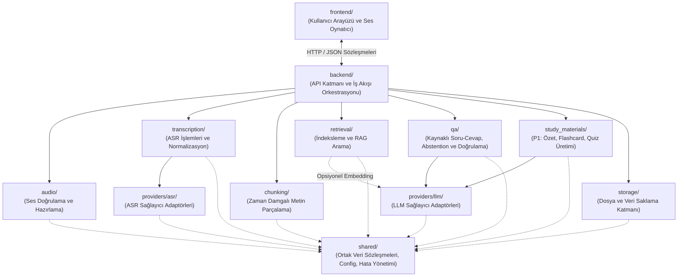
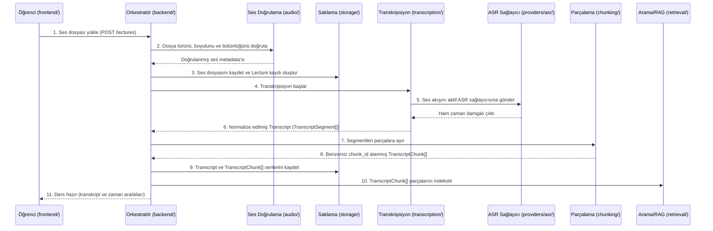
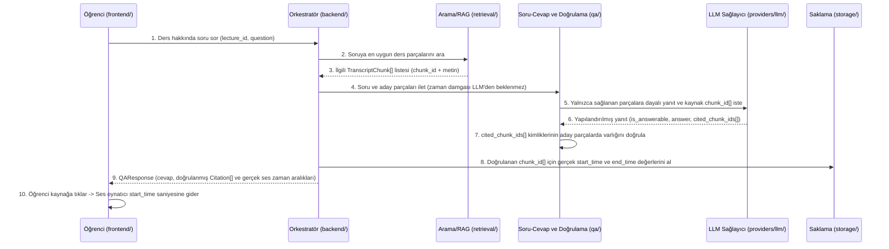

# LectureAssistant — Teknik Mimari Haritası (`architecture.md`)

> **Belge Amacı:** Bu doküman, **LectureAssistant** projesinin ana teknik haritasıdır. Projeye ilk kez dahil olan bir AI agent veya geliştirici, kod tabanını taramadan önce sistemin nasıl bölündüğünü, modüllerin nasıl iletişim kurduğunu ve hangi sorunda nereye bakması gerektiğini bu belgeden öğrenir.
>
> Ürün kapsamı ve kullanıcı gereksinimleri için [`prd.md`](./prd.md), çalışma kuralları için [`agent.md`](./agent.md) dosyasına bakınız.

---

## 1. Genel Teknik Mimari

LectureAssistant, **sorumlulukları ayrıştırılmış modüler bir mimari (Modular Domain Architecture)** üzerine kurulmuştur. Sistemin temel tasarım felsefesi şu dört direğe dayanır:

1. **Tek Sorumluluk ve Gevşek Bağlılık (Loose Coupling):** Her ana klasör yalnızca tek bir iş alanından (domain) sorumludur. Modüller birbirlerinin iç implementasyon detaylarını bilmez; yalnızca [`shared/contracts.schema.json`](./shared/contracts.schema.json) ile tanımlanan açık veri sözleşmeleri üzerinden iletişim kurar.
2. **Sağlayıcı Bağımsızlığı (Provider-Agnostic AI Layer):** Ses-metin dönüştürme (ASR) ve büyük dil modeli (LLM) çağrıları iş mantığından tamamen izole edilmiştir. Varsayılan yaklaşım **API tabanlı harici AI servisleridir** (kullanıcı bilgisayarlarının güçlü donanıma sahip olduğu varsayılmaz); yerel model çalıştırma ileride aynı sağlayıcı arayüzü altına yeni bir adaptör olarak eklenebilir.
3. **Deterministik Kaynak Doğrulama (`chunk_id` Grounding):** LLM hiçbir zaman doğrudan zaman damgası (`start_time`, `end_time`) üretmez veya uyduramaz. Her transkript parçasına sistem tarafından benzersiz bir `chunk_id` atanır. LLM yalnızca kullandığı `chunk_id` referanslarını döndürür; uygulama bu kimlikleri doğrular ve gerçek zaman damgalarını kendi veri deposundan (`storage/`) çözümler.
4. **RAG, Kaynak Doğrulama ve Cevap Verilememe (Abstention) Ayrımı:**
   - İlgili ders parçalarını bulma sorumluluğu [`retrieval/`](./retrieval/agent.md) modülündedir.
   - Bağlamın soruyu yanıtlamak için yeterli olup olmadığına (Abstention), LLM yanıtının üretilmesine ve dönen `chunk_id` referanslarının doğrulanıp zaman damgalarıyla eşleştirilmesine [`qa/`](./qa/agent.md) (ve P1 materyalleri için [`study_materials/`](./study_materials/agent.md)) modülü karar verir.

---

## 2. Ana Klasörler ve Sorumlulukları

Projede her ana klasör tek bir temel sorumluluk taşır ve kendi içinde bir [`agent.md`](./agent.md) kılavuzuna sahiptir:

| Klasör | Temel Sorumluluk | İlgili Kılavuz |
| :--- | :--- | :--- |
| [`frontend/`](./frontend/agent.md) | Öğrenci arayüzü: ses yükleme, zaman damgalı transkript görünümü, belirli zaman aralığından ses çalabilen oynatıcı, kaynak kartlı Q&A ve çalışma materyali ekranları. **API anahtarı veya iş mantığı barındırmaz.** | [`frontend/agent.md`](./frontend/agent.md) |
| [`backend/`](./backend/agent.md) | Uygulama giriş noktası, HTTP API uç noktaları, istek/yanıt şema doğrulaması, merkezi hata yönetimi ve domain modülleri arasındaki iş akışı orkestrasyonu. | [`backend/agent.md`](./backend/agent.md) |
| [`audio/`](./audio/agent.md) | Yüklenen ses dosyalarının format, MIME türü, boyut ve süre açısından doğrulanması; güvenli dosya adlandırma ve ASR öncesi ses hazırlama işlemleri. | [`audio/agent.md`](./audio/agent.md) |
| [`transcription/`](./transcription/agent.md) | Ses kaydının `providers/asr/` üzerinden yazıya dönüştürülmesi ve farklı sağlayıcı çıktılarının standart zaman damgalı `Transcript` ve `TranscriptSegment` modellerine normalize edilmesi. | [`transcription/agent.md`](./transcription/agent.md) |
| [`chunking/`](./chunking/agent.md) | Normalize edilmiş zaman damgalı transkript segmentlerinin anlam bütünlüğünü ve `start_time` / `end_time` sınırlarını koruyarak benzersiz `chunk_id` kimlikli `TranscriptChunk` parçalarına ayrılması. | [`chunking/agent.md`](./chunking/agent.md) |
| [`retrieval/`](./retrieval/agent.md) | `TranscriptChunk` parçalarının indekslenmesi ve kullanıcı sorusuna göre en ilgili ders parçalarının (`chunk_id` ile birlikte) aranıp getirilmesi (RAG arama katmanı). | [`retrieval/agent.md`](./retrieval/agent.md) |
| [`qa/`](./qa/agent.md) | Getirilen ders parçalarına dayanarak soru-cevap üretimi, kayıtta bilgi yoksa cevap vermeme (Abstention) kararı, LLM'in döndürdüğü `chunk_id` kaynaklarının doğrulanması ve gerçek zaman aralıklarıyla eşleştirilmesi. | [`qa/agent.md`](./qa/agent.md) |
| [`study_materials/`](./study_materials/agent.md) | P1 kapsamındaki ders özeti (Map-Reduce), flashcard ve çoktan seçmeli quiz üretimi; üretilen tüm içeriklerde `chunk_id` kaynak doğrulaması. | [`study_materials/agent.md`](./study_materials/agent.md) |
| [`providers/`](./providers/agent.md) | Harici (ve ileride opsiyonel yerel) AI servislerinin ortak soyutlama katmanı, zaman aşımı (timeout), yeniden deneme (retry) ve sağlayıcı hata dönüşümleri. | [`providers/agent.md`](./providers/agent.md) |
| [`storage/`](./storage/agent.md) | Yüklenen ses dosyalarının, geçici dosyaların ve ders/transkript/chunk verilerinin saklanması, sorgulanması ve silinmesi (TTL/temizleme politikaları dahil). | [`storage/agent.md`](./storage/agent.md) |
| [`shared/`](./shared/agent.md) | Tüm modüllerin paylaştığı veri modelleri ve şema sözleşmeleri, ortam değişkeni (`env`) konfigürasyon okuyucusu, merkezi hata sınıfları ve güvenli loglama yardımcıları. | [`shared/agent.md`](./shared/agent.md) |
| [`docs/`](./docs/agent.md) | Mimari Karar Kayıtları (ADR), sağlayıcı değerlendirme notları ve ek teknik tasarım belgeleri. | [`docs/agent.md`](./docs/agent.md) |
| [`tests/`](./tests/agent.md) | Mimari yapı doğrulaması, veri sözleşmesi testleri, birim testleri ve sahte (mock) sağlayıcılarla uçtan uca entegrasyon testleri. | [`tests/agent.md`](./tests/agent.md) |

---

## 3. Alt Klasörler ve Görevleri

Gereksiz iç içe klasör katmanlarından kaçınılmış; yalnızca sağlayıcı izolasyonu için `providers/` altında iki zorunlu alt klasör tanımlanmıştır:

| Alt Klasör | Görevi | İlgili Kılavuz |
| :--- | :--- | :--- |
| [`providers/asr/`](./providers/asr/agent.md) | Speech-to-Text (ASR) sağlayıcı arayüzü ve sağlayıcıya özel adaptörler (Adaylar: Gemini 3.5 Transcribe, Groq Whisper, OpenAI Transcription; ileride opsiyonel yerel Whisper). | [`providers/asr/agent.md`](./providers/asr/agent.md) |
| [`providers/llm/`](./providers/llm/agent.md) | Metin üretimi, yapılandırılmış çıktı (JSON) ve opsiyonel embedding için LLM sağlayıcı arayüzü ve adaptörler (Adaylar: Gemini API, OpenAI API, Groq, Cerebras; ileride opsiyonel yerel LLM). | [`providers/llm/agent.md`](./providers/llm/agent.md) |

---

## 4. Önemli Dosyalar ve Görevleri

| Dosya Yolu | Görevi |
| :--- | :--- |
| [`architecture.md`](./architecture.md) | Projenin genel teknik haritası, modül sınırları, veri akışı ve "Nereye Bakmalıyım?" rehberi. |
| [`prd.md`](./prd.md) | Teknik mimariden bağımsız Ürün Gereksinim Dokümanı (P0/P1/P2 kapsamı, kullanıcı akışları, gizlilik kuralları). |
| [`agent.md`](./agent.md) | Tüm AI agent'lar için bağlayıcı çalışma protokolü, dokümantasyon güncelleme kuralları ve kök dizin değişiklik geçmişi. |
| [`.env.example`](./.env.example) | Uygulamanın ihtiyaç duyduğu ortam değişkenlerinin (ASR/LLM sağlayıcı seçimi, API anahtarı isimleri, dosya limitleri) sahte/örnek şablonu. Gerçek secret içermez. |
| [`.gitignore`](./.gitignore) | `.env` dosyalarının, yüklenen kullanıcı ses kayıtlarının, geçici dosyaların ve derleme çıktılarının Git deposuna girmesini engelleyen kurallar. |
| [`shared/contracts.schema.json`](./shared/contracts.schema.json) | Modüller arasındaki iletişimi belirleyen programlama dilinden bağımsız kanonik veri sözleşmeleri (`Lecture`, `TranscriptSegment`, `TranscriptChunk`, `Citation`, `QAResponse`, `StudyMaterials`, `StandardError`). |
| [`docs/adr-001-modular-provider-and-citation-architecture.md`](./docs/adr-001-modular-provider-and-citation-architecture.md) | Temel mimari kararların (`chunk_id` doğrulaması, ASR/LLM ayrımı, teknoloji bağımsız başlangıç iskeleti) gerekçelerini açıklayan Mimari Karar Kaydı (ADR). |
| [`tests/verify_skeleton.mjs`](./tests/verify_skeleton.mjs) | Klasör yapısının, üç seviyeli dokümantasyon kurallarının, `.env.example` güvenliğinin ve `shared/contracts.schema.json` veri sözleşmelerinin bütünlüğünü denetleyen sıfır bağımlılıklı doğrulama testi. |

---

## 5. Modüllerin Birbirleriyle İletişim Kuralları

1. **Orkestrasyon Üzerinden İletişim (Hub-and-Spoke):** Domain modülleri (`audio`, `transcription`, `chunking`, `retrieval`, `qa`, `study_materials`) birbirlerini doğrudan zincirleme çağırmaz. Akış sırasını [`backend/`](./backend/agent.md) katmanındaki uygulama servisleri koordine eder.
2. **Standart Veri Sözleşmeleri:** Bir modülün çıktısı diğer modülün girdisi olurken yalnızca [`shared/contracts.schema.json`](./shared/contracts.schema.json) içinde tanımlı veri yapıları kullanılır. Örneğin `transcription/` modülü hiçbir zaman sağlayıcıya özel ham JSON döndürmez; standart `Transcript` nesnesi döndürür.
3. **Yalıtılmış Sağlayıcı Erişimi:**
   - `providers/asr/` yalnızca `transcription/` modülü tarafından çağrılır.
   - `providers/llm/` yalnızca `qa/`, `study_materials/` ve (vektör/embedding araması kullanılırsa) `retrieval/` modülü tarafından çağrılır.
   - `frontend/`, `audio/`, `chunking/` veya `storage/` hiçbir zaman doğrudan AI sağlayıcılarına erişmez.

---

## 6. Uçtan Uca Veri Akışı

### A. Ders Yükleme ve Hazırlama Akışı (Ingestion Pipeline)

### B. Kaynaklı Soru-Cevap ve Zaman Aralığı Çözümleme Akışı (Grounded Q&A Pipeline)

### C. Ek Çalışma Materyali Üretim Akışı (P1 — Özet, Flashcard, Quiz)

1. **Özet (Map-Reduce):** `backend/` derse ait sıralı `TranscriptChunk[]` parçalarını `study_materials/` modülüne verir. Uzun dersler bölüm gruplarına ayrılır (Map aşaması), her bölüm `chunk_id` referanslarını koruyarak özetlenir ve ardından birleştirilerek (Reduce aşaması) her ana başlığı doğrulanmış `chunk_id` ve gerçek zaman aralıklarına bağlı bütünsel ders özeti üretilir.
2. **Flashcard ve Quiz:** İlgili ders parçalarından `providers/llm/` aracılığıyla yapılandırılmış kartlar veya çoktan seçmeli sorular üretilir. Her kart ve quiz sorusu en az bir geçerli `chunk_id` içermek zorundadır; `chunk_id` doğrulamasından geçmeyen maddeler elenir ve kalan maddelere gerçek `start_time` / `end_time` bilgileri eklenir.

---

## 7. Modüller Arasındaki Bağımlılıklar ve Yön Kuralları

Bağımlılıklar **tek yönlü (acyclic)** olmak zorundadır:

| Modül | Bağımlı Olabileceği Modüller | Kesinlikle Bağımlı Olamayacağı Modüller |
| :--- | :--- | :--- |
| `shared/` | *(Hiçbir iç modüle bağımlı değildir)* | Diğer tüm modüller |
| `providers/asr/` | `shared/` | `frontend/`, `backend/`, `qa/`, `retrieval/`, `providers/llm/` |
| `providers/llm/` | `shared/` | `frontend/`, `backend/`, `transcription/`, `providers/asr/` |
| `storage/` | `shared/` | `frontend/`, `providers/`, `qa/`, `study_materials/` |
| `audio/` | `shared/` | `providers/`, `qa/`, `retrieval/`, `study_materials/`, `frontend/` |
| `transcription/` | `shared/`, `providers/asr/` | `providers/llm/`, `qa/`, `retrieval/`, `chunking/`, `frontend/` |
| `chunking/` | `shared/` | `providers/`, `storage/`, `qa/`, `retrieval/`, `frontend/` |
| `retrieval/` | `shared/`, *(opsiyonel)* `providers/llm/` | `providers/asr/`, `qa/`, `study_materials/`, `frontend/` |
| `qa/` | `shared/`, `providers/llm/` | `providers/asr/`, `audio/`, `transcription/`, `frontend/` |
| `study_materials/` | `shared/`, `providers/llm/` | `providers/asr/`, `audio/`, `transcription/`, `frontend/` |
| `backend/` | Tüm backend domain modülleri, `storage/`, `shared/` | `frontend/` |
| `frontend/` | Yalnızca `backend/` HTTP API sözleşmeleri | Tüm sunucu modülleri, `providers/`, `storage/` |

---

## 8. Önemli Arayüzler ve Veri Sözleşmeleri

Tüm kanonik şemalar [`shared/contracts.schema.json`](./shared/contracts.schema.json) dosyasında tanımlanmıştır. Temel sözleşmelerin özeti:

1. **`Lecture`**: `lecture_id`, `title`, `audio_metadata` (`filename`, `mime_type`, `size_bytes`, `duration_seconds`), `status` (`uploaded` | `transcribing` | `chunking` | `indexing` | `ready` | `failed`), `created_at`.
2. **`TranscriptSegment`**: Ham ASR çıktısının normalize edilmiş en küçük birimi: `segment_id`, `start_time` (saniye, float >= 0), `end_time` (saniye, float > `start_time`), `text`.
3. **`TranscriptChunk`**: RAG ve kaynak doğrulamanın temel birimi:
   - `chunk_id` (Benzersiz ve deterministik/izlenebilir kimlik, örn. `chk_0001`)
   - `lecture_id`
   - `chunk_index`
   - `start_time` (İçerdiği ilk segmentin başlangıç saniyesi)
   - `end_time` (İçerdiği son segmentin bitiş saniyesi)
   - `text` (Birleştirilmiş konuşma metni)
   - `segment_ids` (Oluşturulduğu `TranscriptSegment` kimlikleri)
4. **`Citation` (Doğrulanmış Kaynak Referansı)**:
   - `chunk_id` (LLM tarafından referans verilen ve sistem tarafından doğrulanan kimlik)
   - `start_time` (**Yalnızca** sistem deposundan çözümlenen gerçek başlangıç saniyesi)
   - `end_time` (**Yalnızca** sistem deposundan çözümlenen gerçek bitiş saniyesi)
   - `quote_text` (İlgili `TranscriptChunk` metni veya kesiti)
5. **`QAResponse`**:
   - `lecture_id`
   - `question`
   - `status`: `answered` | `unanswerable_from_recording`
   - `answer`: Cevap metni veya kayıtta bulunmadığını belirten standart açıklama
   - `citations`: `Citation[]` (`status === "answered"` ise en az 1 doğrulanmış kaynak zorunludur; `unanswerable_from_recording` ise boş dizidir)
6. **Sağlayıcı Arayüzleri (`ASRProvider` & `LLMProvider`)**:
   - `ASRProvider.transcribe(audioInput, options) -> RawASRResult`
   - `LLMProvider.generateStructured(prompt, schema, options) -> StructuredLLMResult`

---

## 9. Uygulamanın Başlangıç Noktaları (Entry Points)

Proje şu an mimari iskelet aşamasındadır. Tanımlanan başlangıç noktaları:

1. **Yapı ve Sözleşme Doğrulama Giriş Noktası (Aktif):**
   - [`tests/verify_skeleton.mjs`](./tests/verify_skeleton.mjs) (`node --test tests/verify_skeleton.mjs` komutuyla çalıştırılır).
2. **Backend Uygulama Giriş Noktası (Teknoloji seçimi sonrası oluşturulacak):**
   - [`backend/`](./backend/agent.md) altında yer alacak ana sunucu başlatıcısı (ortam değişkenlerini doğrular, seçili ASR/LLM sağlayıcı adaptörlerini bağlar ve HTTP API rotalarını açar).
3. **Frontend İstemci Giriş Noktası (Teknoloji seçimi sonrası oluşturulacak):**
   - [`frontend/`](./frontend/agent.md) altında yer alacak web arayüzü başlatıcısı.

---

## 10. "Nereye Bakmalıyım?" — Hızlı Sorun ve Görev Yönlendirme Rehberi

Bir hata ayıklarken veya özellik geliştirirken tüm projeyi taramak yerine aşağıdaki tabloyu kullanarak doğrudan ilgili klasörün `agent.md` dosyasına gidin:

| Sorun veya Görev Alanı | İlk Bakılacak Klasör / Dosya | İkincil İlgili Klasör |
| :--- | :--- | :--- |
| **Ses dosyası yükleme, format/boyut reddi, bozuk ses hatası** | [`audio/agent.md`](./audio/agent.md) | [`storage/agent.md`](./storage/agent.md) |
| **Sesin yazıya dönüştürülmesi (transkripsiyon) veya segment zaman kayması** | [`transcription/agent.md`](./transcription/agent.md) | [`providers/asr/agent.md`](./providers/asr/agent.md) |
| **ASR API bağlantı, kimlik doğrulama veya timeout problemi** | [`providers/asr/agent.md`](./providers/asr/agent.md) | [`providers/agent.md`](./providers/agent.md) |
| **Transkriptin çok kısa/uzun bölünmesi veya `chunk_id` üretimi problemi** | [`chunking/agent.md`](./chunking/agent.md) | [`shared/agent.md`](./shared/agent.md) |
| **Soruya uygun ders bölümlerinin bulunamaması (arama/RAG kalitesi)** | [`retrieval/agent.md`](./retrieval/agent.md) | [`chunking/agent.md`](./chunking/agent.md) |
| **Cevabın doğruluğu, kayıtta olmayan bilgiye cevap verme (halüsinasyon) veya `chunk_id` doğrulama problemi** | [`qa/agent.md`](./qa/agent.md) | [`retrieval/agent.md`](./retrieval/agent.md) |
| **Ders özeti (Map-Reduce), Flashcard veya Quiz üretim problemi** | [`study_materials/agent.md`](./study_materials/agent.md) | [`qa/agent.md`](./qa/agent.md) |
| **LLM API bağlantısı, yapılandırılmış JSON çıktı hatası veya rate-limit** | [`providers/llm/agent.md`](./providers/llm/agent.md) | [`providers/agent.md`](./providers/agent.md) |
| **Ses oynatıcının ilgili saniyeye atlamaması veya arayüz gösterim hatası** | [`frontend/agent.md`](./frontend/agent.md) | [`backend/agent.md`](./backend/agent.md) |
| **Dosyaların kaydedilmesi, geçici dosyaların silinmesi veya veri kaybı** | [`storage/agent.md`](./storage/agent.md) | [`audio/agent.md`](./audio/agent.md) |
| **HTTP endpoint sözleşmesi, durum kodları veya iş akışı sırası problemi** | [`backend/agent.md`](./backend/agent.md) | [`shared/agent.md`](./shared/agent.md) |
| **Ortak veri şemaları (`chunk_id`, `Citation`) veya `.env` okuma problemi** | [`shared/agent.md`](./shared/agent.md) | [`shared/contracts.schema.json`](./shared/contracts.schema.json) |
| **Bir özelliğin MVP (P0) kapsamında olup olmadığını kontrol etme** | [`prd.md`](./prd.md) | [`architecture.md`](./architecture.md) |

---

## 11. Yeni Bir Özellik Eklenirken Etkilenecek Modüller (Değişim Etki Matrisi)

| Senaryo | Etkilenen Modüller | Etkilenmemesi Gereken Modüller |
| :--- | :--- | :--- |
| **Yeni bir ASR sağlayıcısı eklemek (örn. Groq Whisper -> Gemini Transcribe)** | Yalnızca `providers/asr/` ve `.env.example` | `transcription/`, `chunking/`, `retrieval/`, `qa/`, `frontend/` |
| **Yeni bir LLM sağlayıcısı eklemek (örn. OpenAI -> Cerebras / Gemini)** | Yalnızca `providers/llm/` ve `.env.example` | `qa/`, `study_materials/`, `retrieval/`, `frontend/` |
| **Metin parçalama (chunking) algoritmasını değiştirmek** | Yalnızca `chunking/` ve ilgili birim testleri (`tests/`) | `transcription/`, `qa/`, `providers/`, `frontend/` |
| **Arama yöntemini değiştirmek (BM25 -> Hibrit/Vektör arama)** | Yalnızca `retrieval/` ve `storage/` (indeks saklama) | `chunking/`, `qa/`, `study_materials/`, `frontend/` |
| **Yeni bir çalışma materyali türü eklemek (P1/P2)** | `study_materials/`, `shared/contracts.schema.json`, `backend/`, `frontend/` | `audio/`, `transcription/`, `chunking/`, `retrieval/`, `qa/` |

---

## 12. Birbirinden Bağımsız Geliştirilebilecek Modüller

[`shared/contracts.schema.json`](./shared/contracts.schema.json) içerisindeki veri sözleşmeleri sabit tutulduğu sürece aşağıdaki modüller sahte (mock/fixture) verilerle **tamamen paralel ve birbirinden bağımsız** olarak geliştirilebilir:

1. **`chunking/` Modülü:** Girdi olarak örnek bir `TranscriptSegment[]` JSON dizisi alır ve `TranscriptChunk[]` üretir. Hiçbir harici API veya veritabanına ihtiyaç duymadan tek başına kodlanıp test edilebilir.
2. **`qa/` (Kaynak Doğrulama ve Cevaplama) Modülü:** Örnek `TranscriptChunk[]` parçaları ve sahte bir `LLMProvider` ile kaynak doğrulama (`chunk_id` kontrolü) ve cevap verilememe (Abstention) mantığı bağımsız geliştirilebilir.
3. **`providers/asr/` ve `providers/llm/` Adaptörleri:** Standart sağlayıcı arayüzlerine uyacak şekilde birbirlerinden ve iş mantığından bağımsız geliştirilebilir.
4. **`frontend/` Arayüzü:** `shared/contracts.schema.json` şemasına uygun örnek (mock) API yanıtlarıyla backend tamamlanmadan geliştirilebilir.

---

## 13. Önemli Mimari Kararlar ve Henüz Kesinleşmemiş Konular

### Alınan Temel Mimari Kararlar (Detaylar: [`docs/adr-001`](./docs/adr-001-modular-provider-and-citation-architecture.md))
1. **LLM Zaman Damgası Üretemez (`chunk_id` Zorunluluğu):** Dil modelleri sayısal zaman aralıklarında halüsinasyon görmeye yatkındır. Bu nedenle LLM yalnızca `chunk_id` döndürür; `start_time` ve `end_time` değerleri uygulama tarafından deterministik olarak çözümlenir.
2. **Transkript Modelleri İçin Ayrı Klasör Açılmaması:** Gereksiz klasör katmanı oluşturmamak adına temel veri sözleşmeleri `shared/` içinde, transkripsiyon işleme ve normalizasyon mantığı `transcription/` içinde konumlandırılmıştır.
3. **API Varsayılan, Yerel Model Opsiyonel:** Öğrenci bilgisayarlarında güçlü GPU/RAM bulunmayabileceği için mimari varsayılan olarak hafif istemci + API tabanlı AI sağlayıcıları üzerine kurulmuştur.

### Henüz Kesinleşmemiş Teknik Kararlar (Açık Noktalar)
Aşağıdaki konular bilinçli olarak sabitlenmemiş olup geliştirme aşamasına geçilirken kararlaştırılacaktır:
- **Backend Programlama Dili ve Web Framework'ü:** (Örn. Python/FastAPI veya Node.js/TypeScript).
- **Frontend Framework'ü:** (Örn. React, Next.js, Vue veya hafif bir SPA).
- **Varsayılan ASR Sağlayıcısı:** Adaylar: *Gemini 3.5 Transcribe*, *Groq Whisper*, *OpenAI Transcription*.
- **Varsayılan LLM Sağlayıcısı:** Adaylar: *Gemini API*, *OpenAI API*, *Groq*, *Cerebras*.
- **Arama (Retrieval) ve Kalıcılık Teknolojisi:** MVP için hafif yerel/ilişkisel depolama + anahtar kelime (BM25) ve/veya API tabanlı embedding araması seçenekleri değerlendirilecektir.

